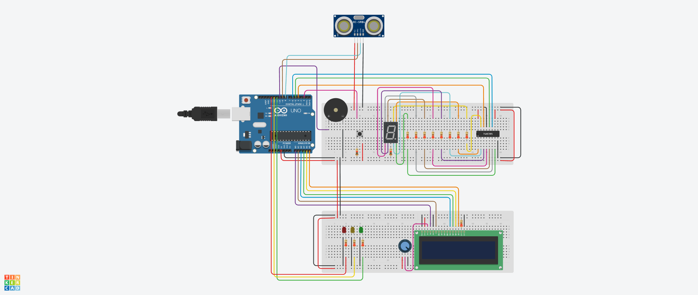

# Advanced Parking Assistant System

A two-person Real-Time Systems course project that uses an Arduino Uno to measure obstacle distance and indicate proximity with LEDs, a seven-segment display, and a piezo buzzer. A 16×2 LCD displays the current distance and the 30 cm limit. A push button toggles the audio while the visual indicators continue to update.

## How it works

| Distance | LED | Seven-segment display | Buzzer when enabled |
| --- | --- | --- | --- |
| Over 60 cm | Green | 0 | Silent |
| Over 30 cm through 60 cm | Yellow | 5 | Intermittent 1 kHz tone |
| 30 cm or less | Red | 9 | Continuous 1 kHz tone |

The HC-SR04 emits a pulse when triggered. The ATmega328P's Timer1 input capture measures the echo on D8 (PB0 / ICP1). D2 (PD2 / INT0) handles the falling edge from the mute button. The firmware sends readings and sound status over USART at 9600 baud, drives the LCD in four-bit mode, and clocks the seven-segment pattern through a 74HC595 shift register.

| Function | Arduino Uno pins |
| --- | --- |
| HC-SR04 | Trigger D9, echo D8 |
| Mute button | D2, active low with internal pull-up |
| 74HC595 | Data D4, latch D5, clock D6 |
| Piezo buzzer | D10 |
| Green, yellow, red LEDs | D11, D12, D13 |
| LCD | RS A0, EN A1, D4–D7 on A2–A5 |

The two breadboards share power and ground. The split layout groups the LCD and LEDs on one board and the range sensor, buzzer, and seven-segment circuitry on the other.

## Build

From the project root with PlatformIO installed:

    pio run

With an Arduino Uno connected, use `pio run -t upload` and `pio device monitor`. If automatic port selection is ambiguous, pass `--upload-port` or `--port` with your board's serial port.

## Testing and scope

The team tested the circuit integration in Tinkercad. The PlatformIO build checks that the AVR firmware compiles. The source uses a loop-count echo timeout that returns 999 cm on a missing echo, which the current logic interprets as beyond the warning range. A hardware-ready design would need an explicit sensor-fault state, button debounce, and physical validation.

## Contributions

**Oritse-Tsegbemi Eyito** led hardware architecture and integration testing, co-designed the two-breadboard layout, resolved the ICP1 and INT0 pin conflicts, and debugged the LCD and shift-register bit handling.

**Nifemi Ogunmeru** co-designed and assembled the Tinkercad layout, tested and debugged the circuit, and prepared the report and demonstration recording. The ultrasonic module builds on timer code and calculations from the course.
